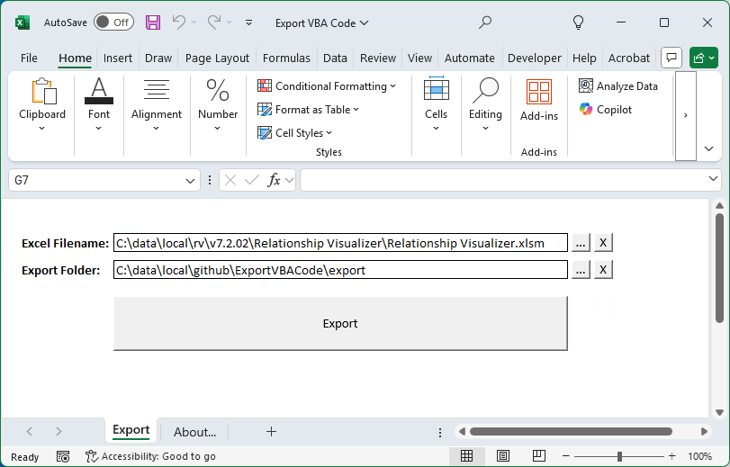
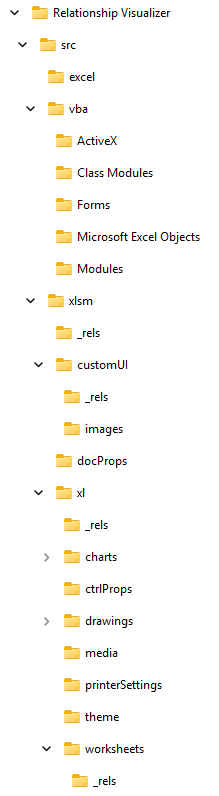
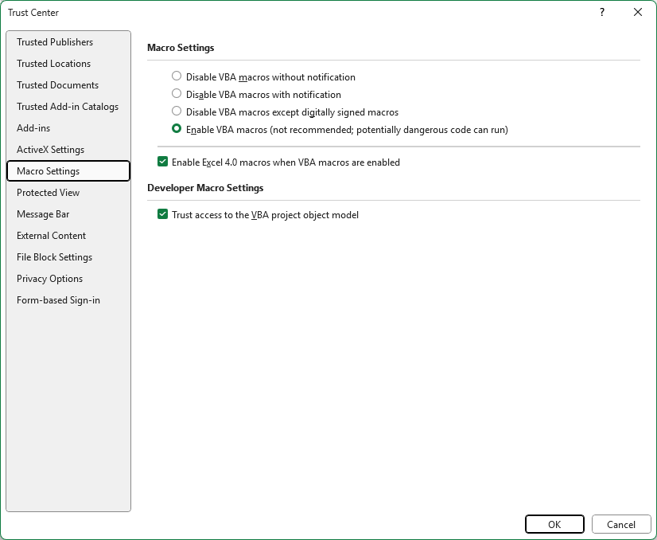

# ExportVBACode
_Deconstructs a macro-enabled Excel workbook into its individual parts for external use or inspection._

## Overview
This repository contains the macro-enabled Excel workbook `Export VBA Code.xlsm` that allows you to extract the embedded contents (such as modules, forms, sheets, and other objects) from another macro-enabled Excel file, and write each item to a structured directory tree on your system.

**Key features:**
- Extracts VBA modules, user forms, and class modules from target `.xlsm` files
- Exports worksheet code and other embedded objects such as custom FluentUI ribbon tabs and image files
- Organizes extracted files into a clear, navigable folder structure
- Provides a simple interface for selecting source and destination paths

## Getting Started
### Prerequisites
- Microsoft Excel 2016 or later (Windows only, due to VBA limitations)
- Basic familiarity with Excel macros and the VBA editor
- Write access to the directories where you plan to extract files

### Installation
1. Review the [Security Considerations for Trusting a Macro-Enabled Excel Workbook from GitHub](./SECURITY.md) before proceeding.
2. Download or clone this repository to your local machine.
3. Downloaded files may be marked as **"blocked"** by Windows, preventing macros from running. 
   To unblock the file:
   - **Locate the File**
     - Navigate to the folder containing the downloaded `.xlsm` file (e.g., in File Explorer).

   - **Check File Properties**
     - Right-click the Excel file and select **Properties**.
     - In the **General** tab, look for a message at the bottom stating, *This file came from another computer and might be blocked to help protect this computer.*

   - **Unblock the File**
     - Check the **Unblock** checkbox next to the message.
     - Click the **Apply** button.
     - Click **OK** to save the changes.

    *Note*: If you don’t see an **"Unblock"** option, the file may not be marked as blocked, and you can proceed to the next steps.

4. Open the Workbook 
   - Double-click the `Export VBA Code.xlsm` file to open it in Microsoft Excel.

5. Enable Macros
   - If macros are disabled with notification (recommended setting), Excel will display a security warning bar stating, **"Macros have been disabled"**. 
   - Click **Enable Content** or **Enable Macros** in the warning bar to allow the macros to run for this session. 
   - See [Macro Permissions Required](#macro-permissions-required) below for details on how to change your Trust Center settings.

## Usage
1. Make the `Export` worksheet the active worksheet.
2. Select as `Excel Filename` the source `.xlsm` Excel file you wish to extract the contents from.
3. Choose the `Export Folder` directory where the exported files should be written to.
4. Press the giant `Export` button.

    

5. The `Export` macro will create a directory within the `Export Folder` matching the name of the source Excel file. It will then write the spreadsheet contents to organized folders such as illustrated in the tree below. The actual contents of the tree will vary depending upon the various assets contained within the workbook.

    |  |
    | -------------------------------------------------- |

6. The export is complete when you see the message **Done!** displayed in the status bar.
7. After running the workbook, consider resetting macro settings to **Disable VBA macros with notification** for added security.

## Macro Permissions Required

Good security practices to follow **before enabling the macros** are to:
1. **Inspect the Macro Code**: Before enabling macros, open the VBA editor (Alt+F11) to review the code for suspicious activity (e.g., network calls, file modifications). 
   
   - This tool has exported its own VBA source code, and you can view it [here](./export/Export%20VBA%20Code/src/vba/Modules/modExport.bas).
   - The VBA code in this tool has been analyzed using the [Rubberduck VBA](https://rubberduckvba.com/) static-code analysis tool.

2. **Use a Safe Environment**: Consider opening the file in a virtual machine or sandbox to isolate potential risks.
3. **Backup Data**: Always back up critical data before enabling macros in a downloaded file.
  
To ensure proper operation, you must update your Excel Trust Center Settings as follows:

### Enable Macros
1. Go to **File → Options → Trust Center → Trust Center Settings...**
2. Select **Macro Settings**
3. Choose **Enable all macros** (not recommended for everyday use, but required for this tool)

### Trust Access to the VBA Project Object Model
1. In the Trust Center Settings window, select **Macro Settings**
2. Check the box for **Trust access to the VBA project object model**
3. Click **OK** to save changes

> **Warning:** These settings may expose you to risk from untrusted documents. Reset your macro settings after using this tool.

## Contributing
Contributions, issues, and feature requests are welcome! Please open an issue or submit a pull request.

## License
This project is released under the MIT License. See [LICENSE](./LICENSE) for details.

## Disclaimer
**This tool is provided as-is.** Please make backups of important files before using.

